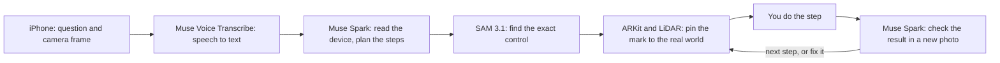

# Kokobubu

**Shows you where to touch. Checks you got it right.**

Kokobubu is an iPhone app that shows you how to use a physical device. Point your iPhone at a washing machine, a screen or a control panel and ask out loud. It reads the labels, marks the exact control in AR, guides you one step at a time, and checks your work with the camera where a photo can show the result.

- **Demo video (2:55):** https://www.youtube.com/watch?v=xyJxzW4g8xU
- **Project page:** https://www.aobasar.com/projects/kokobubu/
- **Try it in a browser (illustrated examples, no install):** https://www.aobasar.com/projects/kokobubu/try/
- **TestFlight:** https://testflight.apple.com/join/jkXDy8nX (the app requires an invitation code, because it uses API credits)

Built for the Meta Global AI Developer Hackathon, Oct 26 – Nov 4, 2026. Track: Indie Developer. Problem statement: Build for Your World. An independent project, not made or endorsed by Meta.

## Why I built it

When I moved to the US, I was still learning English. I stood in front of a washing machine translating every word, and I once shrank my clothes on the wrong dryer setting. How do you ask for help with a button you can't name?

Kokobubu is for people living far from home, people getting used to new technology, and anyone afraid of doing it wrong.

## How it works



| Part | Job |
|---|---|
| Muse Voice Transcribe | Turns the spoken question into text |
| Muse Spark 1.3 | Reads the frame and its labels, plans the steps, asks a question when it needs one, and checks each step against its success condition |
| SAM 3.1 | Finds the control that Muse Spark named, so the mark sits on the real knob or button |
| ARKit and LiDAR | Keep the mark in place while the phone moves. They do no recognition |
| iOS system voice | Reads the steps aloud |

The API key stays on the server and never ships in the app. The app sends frames and audio only when you ask, and the consent screen says so first. See the [privacy page](https://www.aobasar.com/projects/kokobubu/legal/).

## Repository

| Path | What it is |
|---|---|
| `ios-app/` | The iPhone app (SwiftUI, ARKit, RealityKit). The source folder keeps its early name, `NovaGuide` |
| `web-prototype/guide.py` | The guide server the app talks to: plan, verify, ask, transcribe, invite codes and usage logs |
| `web-prototype/server.py`, `ws.py`, `workspace.py`, `static/` | The first-day browser experiment. `guide.py` still builds on `server.py` |
| `web-prototype/tests/` | Python and JavaScript tests |
| `scripts/prototypes/` | Small test scripts used while tuning the models |
| `docs/testflight.md` | What App Store Connect asks for |

The project was first called Nova, then Koko, so some internal names still say Nova.

## Run it

You need a Meta Model API key. For the app you also need a Mac with Xcode, [XcodeGen](https://github.com/yonaskolb/XcodeGen) and a real iPhone, because ARKit doesn't run in the simulator.

**Server**

```bash
cp .env.example .env.local   # set MODEL_API_KEY
scripts/serve.sh             # the browser experiment, http://127.0.0.1:9005
```

For the app's internet route, set `NOVA_PUBLIC_HOST` and `NOVA_GUIDE_PUBLIC_PORT` in `.env.local`, put HTTPS in front of that port, and create a code:

```bash
python3 web-prototype/guide.py invite NAME
```

**App**

```bash
cp ios-app/Config/Local.example.xcconfig ios-app/Config/Local.xcconfig   # set your team and server URL
cd ios-app && xcodegen generate && open Kokobubu.xcodeproj
```

**Tests**

```bash
python3 -m unittest discover web-prototype/tests
node --test web-prototype/tests/
```

The app's unit tests run from Xcode, in the `Kokobubu` scheme.

## Status and limits

An experimental prototype. Tested in Turkish and English; other languages are experimental.

- Guidance is generated by AI and can be wrong. Check before you press. Labels and manuals come first.
- It is not for gas, electrical panels, vehicles or medication. For adults, 18 and up.
- The user does every step. Kokobubu never touches the device.
- A check can only judge what a photo can show.

## How it was made

All of this repository was built during the event, starting Oct 26, 2026; the history starts there. It was developed with the help of AI coding tools. The app's mascot and icon were generated with Muse Image. It uses Apple's system frameworks and no third-party code packages.

## License

Code: [GNU AGPL-3.0](LICENSE). The Kokobubu name and mascot are not licensed: please don't use them for your own product.
